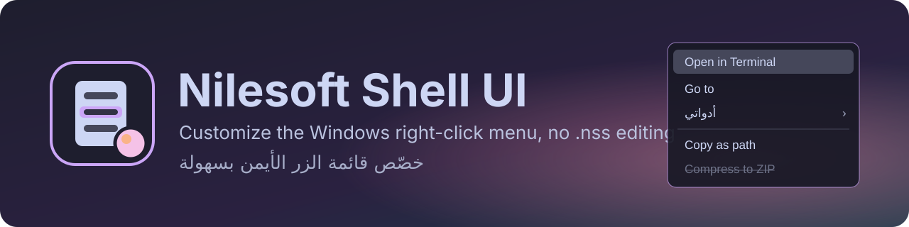
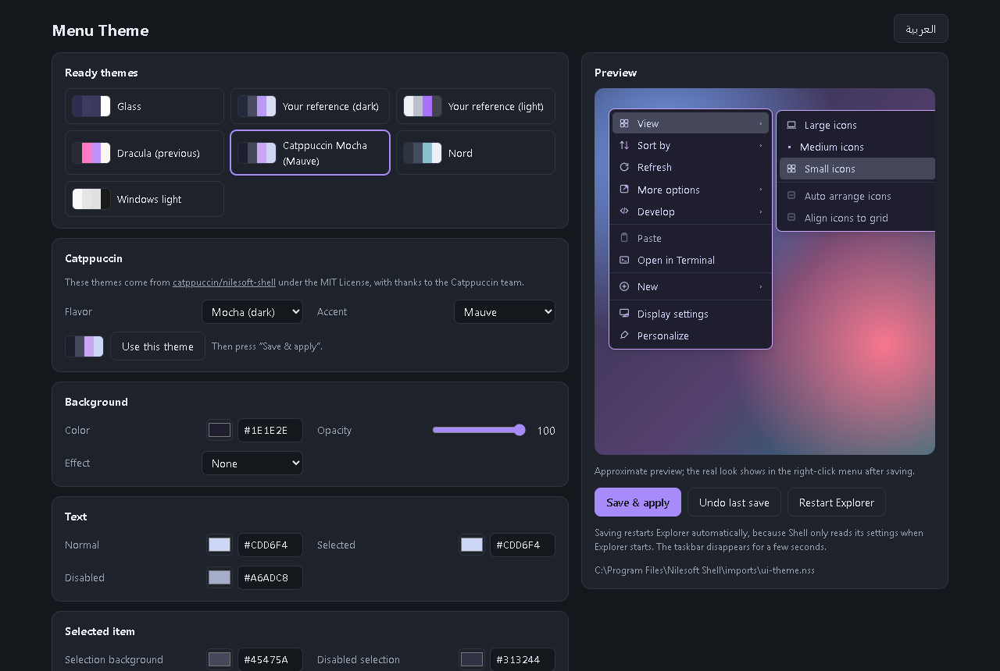
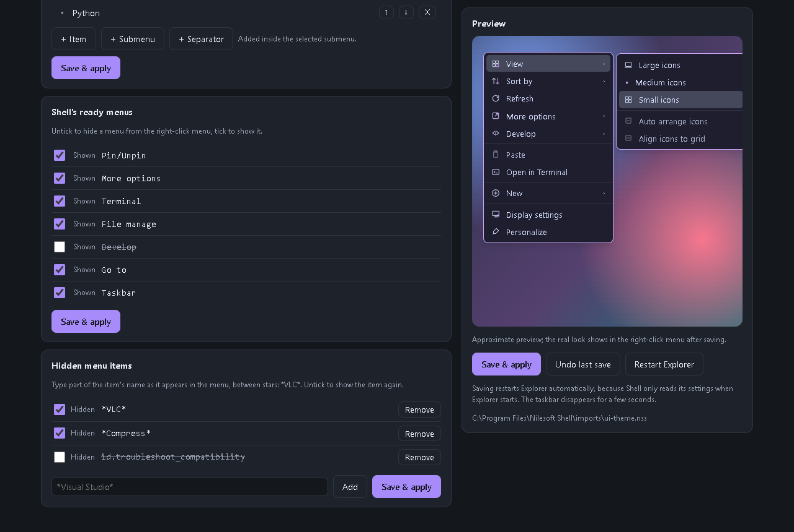
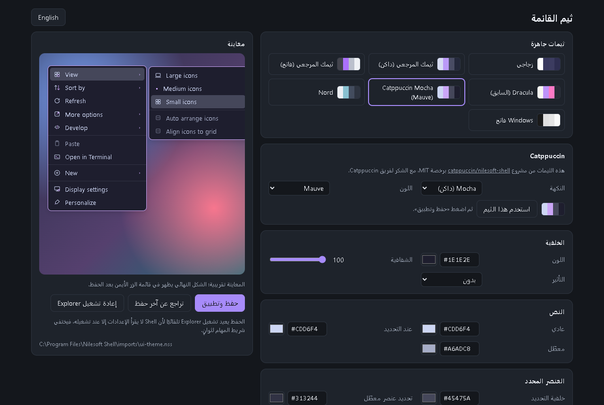
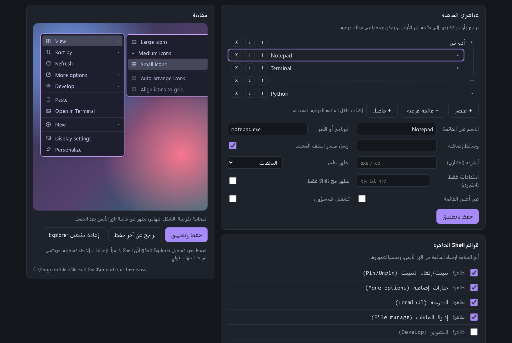

  
  
  
  
  
  

An easy English/Arabic interface for customizing the Windows right-click menu with <a href="https://nilesoft.org">Nilesoft Shell</a>, without editing <code>.nss</code> files by hand. 
واجهة سهلة بالإنجليزية والعربية لتخصيص قائمة الزر الأيمن في Windows عبر Nilesoft Shell، دون تحرير ملفات <code>.nss</code> بيدك.

<a href="#العربية">العربية</a>

## Screenshots

| Theme editor | Shell menus & hidden items |
|---|---|
|  |  |

## Features

- **Theme editor** with a live preview: colors, opacity, effects (blur, acrylic), corners, font and shadow.
- **Ready themes:** 7 themes including Dracula and Nord, plus 56 Catppuccin themes (4 flavors × 14 accents).
- **My items:** add programs and commands to the menu, with submenus and separators, and choose where they show (files, folders, desktop...) and for which extensions.
- **Hide Windows items** you don't need from the menu.
- **Shell's ready menus:** show or hide Terminal, Go to, File manage, Taskbar and more.
- **One-click setup** on first run.
- **Safety:** automatic backups and undo of the last save. If Shell rejects a file, the app restores the previous version on its own.

## Requirements

- Windows 10 or 11.
- [Nilesoft Shell](https://nilesoft.org) installed.
- [Python](https://www.python.org/downloads/) 3.8 or newer. No extra packages needed.
- Microsoft Edge, which ships with Windows. The app opens in its own Edge window, or in your default browser if Edge is missing.

## Running

1. Download or clone the repository: `git clone https://github.com/alimwork85-web/NilesoftShellUI`
2. Double-click `app.pyw`.
3. On first run a **"Set up now"** bar appears. Click it and accept the administrator prompt.

### What setup does

Shell's folder in `Program Files` needs administrator rights to write, so setup asks for them once. Then it:

- backs up the original `shell.nss` as `shell.nss.bak`;
- creates the app's files in `imports` (`ui-theme.nss`, `ui-hide.nss`, `ui-menus.nss`, `ui-items.nss`) and gives your account modify rights on **those files only**;
- links them in `shell.nss` in place of the original theme and ready-menu lines. The first theme file is a copy of your current theme, so the menu looks the same.

After that the app saves without administrator rights. Every save restarts Explorer, because Shell reads its settings only when Explorer starts, so the taskbar disappears for a few seconds.

### Undo everything

Copy `shell.nss.bak` over `shell.nss` in Shell's folder (as administrator), then restart Explorer. You can also delete the `imports\ui-*.nss` files. Backups and app settings are kept in `%APPDATA%\NilesoftShellUI`.

## Privacy

Everything runs on your machine: a local server on `127.0.0.1`, protected by a random token on every run. Nothing is sent to the internet.

## Credits

- The Catppuccin themes come from [catppuccin/nilesoft-shell](https://github.com/catppuccin/nilesoft-shell) under the MIT License. Thanks to the [Catppuccin](https://github.com/catppuccin) team.
- [Nilesoft Shell](https://nilesoft.org) draws the menu. This app is only an interface for it and is not affiliated with Nilesoft.

## License

[MIT](LICENSE) © 2026 Ali Alhumedi. The Catppuccin themes stay under their own license, © 2021 Catppuccin.

---

## صور

| محرر الثيم | عناصري الخاصة وقوائم Shell |
|---|---|
|  |  |

## المميزات

- **محرر الثيم** مع معاينة حية: الألوان، والشفافية، والتأثيرات (Blur وAcrylic)، والحواف، والخط، والظل.
- **ثيمات جاهزة:** 7 ثيمات، منها Dracula وNord، و56 ثيمًا من Catppuccin (4 نكهات × 14 لونًا).
- **عناصري الخاصة:** أضف برامج وأوامر إلى القائمة، وقوائم فرعية وفواصل، وحدّد أين تظهر (الملفات، المجلدات، سطح المكتب...) ولأي امتدادات.
- **إخفاء عناصر Windows** التي لا تحتاجها من القائمة.
- **قوائم Shell الجاهزة:** أظهر أو أخفِ Terminal وGo to وFile manage وTaskbar وغيرها.
- **إعداد بنقرة واحدة** عند أول تشغيل.
- **أمان:** نسخ احتياطية تلقائية، والتراجع عن آخر حفظ، وإن رفض Shell أحد الملفات يعيد التطبيق النسخة السابقة وحده.

## المتطلبات

- Windows 10 أو 11.
- [Nilesoft Shell](https://nilesoft.org) مثبّت.
- [Python](https://www.python.org/downloads/) 3.8 أو أحدث. لا يحتاج أي حزمة إضافية.
- متصفح Microsoft Edge، وهو موجود في Windows أصلًا. التطبيق يفتح فيه نافذة مستقلة، وإن لم يجده يفتح في المتصفح الافتراضي.

## التشغيل

1. نزّل المستودع أو انسخه: `git clone https://github.com/alimwork85-web/NilesoftShellUI`
2. انقر نقرتين على `app.pyw`.
3. في أول تشغيل يظهر شريط **«إعداد الآن»**. اضغطه ووافق على نافذة صلاحية المسؤول.

### ماذا يفعل الإعداد؟

مجلد Shell داخل `Program Files` لا يُكتب إلا بصلاحية المسؤول، لذلك يطلبها الإعداد مرة واحدة فقط، ثم:

- يحفظ نسخة من `shell.nss` الأصلي باسم `shell.nss.bak`.
- ينشئ ملفات الواجهة في `imports`، وهي `ui-theme.nss` و`ui-hide.nss` و`ui-menus.nss` و`ui-items.nss`، ويعطي حسابك صلاحية التعديل عليها **وحدها**.
- يربطها في `shell.nss` مكان السطور الأصلية للثيم وقوائم Shell الجاهزة. ملف الثيم الأول نسخة من ثيمك الحالي، فلا يتغير شكل القائمة.

بعد ذلك يحفظ التطبيق تغييراتك دون صلاحية المسؤول. كل حفظ يعيد تشغيل Explorer لأن Shell لا يقرأ إعداداته إلا عند تشغيله، فيختفي شريط المهام لثوانٍ.

### التراجع الكامل

انسخ `shell.nss.bak` فوق `shell.nss` في مجلد Shell (بصلاحية المسؤول)، ثم أعد تشغيل Explorer. يمكنك أيضًا حذف ملفات `imports\ui-*.nss`. النسخ الاحتياطية وإعدادات التطبيق محفوظة في `%APPDATA%\NilesoftShellUI`.

## الخصوصية

التطبيق يعمل على جهازك فقط: خادم محلي على `127.0.0.1` محمي برمز عشوائي في كل تشغيل، ولا يرسل أي بيانات إلى الإنترنت.

## شكر وتقدير

- ثيمات Catppuccin مأخوذة من مشروع [catppuccin/nilesoft-shell](https://github.com/catppuccin/nilesoft-shell) برخصة MIT. شكرًا لفريق [Catppuccin](https://github.com/catppuccin).
- [Nilesoft Shell](https://nilesoft.org) هو البرنامج الذي يرسم القائمة. هذا التطبيق واجهة له فقط، وليس تابعًا لـ Nilesoft.

## الرخصة

[MIT](LICENSE) © 2026 Ali Alhumedi. وتبقى ثيمات Catppuccin تحت رخصتها، © 2021 Catppuccin.

